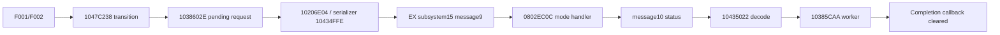

# Nikon Z6 II C1.70 research notes

Current evidence: 2026-11-11. This document describes offline analysis of a
specific firmware build. It is not an installation guide or a recovery procedure.
The research objective is internal N-Log 10-bit recording; that capability has
**not** been demonstrated. Higher bitrate, HDMI output depth, HDMI RAW activation
and internal 10-bit encoding are separate questions.

## Evidence conventions

- **Static:** decoded instructions, literals, initial data and call relationships.
- **Emulated:** original instructions executed with specified synthetic inputs
  and explicit stubs. This proves that isolated path under those assumptions.
- **Hardware-reported:** a third-party report, not independently reproduced here.
- **Inferred:** plausible interpretation, not established component identity.
- **Unverified:** a remaining gap; absence of a discovered write is not proof that
  no other path writes persistent state.

Function pointers have their Thumb bit set; instruction addresses below are even.
`LSLS x,#n` followed by a sign test examines original bit `31-n`. For example,
the `LSLS #0x12` in `0803C5C4` tests event `0x2000`, not `0x40000`.
Raw address matches and function-name strings alone are not control-flow evidence.

## Inputs, provenance and reproducibility

| Input | Size | SHA-256 | Load base |
| --- | ---: | --- | --- |
| Z6_2_0170.bin | 49002888 | `5a9640b4c07abe1ecbf5a52655cbec6b893bba045bb2a1a1d21055b9f8f9d06d` | Container |
| eg1850_mas_01700.bin | 38750138 | `bb83613121f843d65101da936d942acdc513d86dbd3abc26259d0d870d03f5d4` | `10020000` |
| eg1850_sla_01700.bin | 8832194 | `3fd8c2cbdf57fadb03f6d69b596b58a8703efdd61ae82572d5afeea0241a9ed5` | `10020000` |
| ex1850_012000.bi.bin | 524290 | `9c65cad554ed02f83d37fbc825a8eb9efe79e3f32f98894dd5dd73edee416983` | `08000000` |

All five module CRCs and the C1.70 container CRC passed. The original firmware
is not distributed. Other module metadata is in
[modules.json](../work/analysis/modules.json). EX reset vectors are
SP=`20000C08`, reset=`080002B5`; the footer includes version `01.20.00`.

[Pinned source metadata](../work/vendor/sources.json) identifies the reviewed
WonderLantern primitives used for local extraction. Recovery used zero/FF padding
observations, frequency inference for five missing indices, published table
fingerprints, and CRC validation. This is not a signature bypass or an updater test.
No modified update image has been produced.

`ExFirmware.initial_ram()` executes the seven original scatter-load copy,
decompression and zeroing routines from the table `080038CC..0800393C`.
In particular, initialized EX data is compressed; simply copying the ROM bytes
at `08051BA4` does not reproduce initialized RAM. The resulting RAM digest is
recorded by the EX scripts. The inspection helpers enforce input hashes.

### Executable checks

| Script | Scope / checks | Explicit exclusions |
| --- | --- | --- |
| [analyze_bitrate.py](../scripts/analyze_bitrate.py) | 204 selectors + 60 parameter-pipeline cases | Sensor, codec hardware, actual SPS, card recording, heat/stability |
| [analyze_ptp.py](../scripts/analyze_ptp.py) | Eight outer tables, 175 subcommands, four gate cases, identity branch, eight address filters, two memory transfers, ten video getter cases | USB, full boot, physical capability sources; optional local device snapshot is off by default |
| [analyze_service_recovery.py](../scripts/analyze_service_recovery.py) | Ten transition cases + six F002 cases | Low-level cleanup hardware and physical recovery |
| [analyze_config_read.py](../scripts/analyze_config_read.py) | Nine preflight, five read, two commit-dispatch, two packet cases | Real region descriptor, USB and physical NVRAM commit |
| [analyze_ex_service.py](../scripts/analyze_ex_service.py) | 14 EX/master exchange cases | Callback side effects, scheduler and actual transport |
| [analyze_ex_peripherals.py](../scripts/analyze_ex_peripherals.py) | Seven region1 cases + three isolated region6 cases | Real I²C, GPIO, timer clocks, device power-on reset |

JSON outputs are under [work/analysis](../work/analysis). Counts describe cases,
not independent proofs of whole-camera safety. Some cases deliberately inject
failure. A passing assertion can confirm a problematic behavior.

## Internal video and bitrate

The master/slave bitrate tables are byte-identical: 34 records, 32 bytes each.

| Item | Master | Slave |
| --- | --- | --- |
| Table | `1091D594` | `101DCB08` |
| Selector | `10523D08` | `101089F4` |
| Getter | `10523E0A` | `10108AF6` |
| Encoder constructor | `104BE39A` | `100A2322` |
| Level threshold literal | `104BE72C` | `100A26B4` |

Maximum/average bitrate fields are at record offsets `+14/+18` hexadecimal.
4K 30/25/24p High uses rows 4/6/8. The first 28 bytes of Z6 II records 4–33
match the 30-record Z30 C1.20 table, whose stride is 28. Z6 II has an extra field
and two processor modules; the Z30 patch is not directly transferable.

| Configuration | Maximum / target average, Mbps | Selected Level parameter |
| --- | --- | --- |
| Stock | 144 / 120 | 51, corresponding to 5.1 |
| Candidate evaluated in emulator RAM | 156 / 140 | 51 |
| Z30 analogy | 200 / 168 | 61, corresponding to 6.1 |

The original code shifts bitrate by ten bits. Its threshold is `156250`, so
the 4K branch selects Level 61 at a maximum of at least 160,000,000 bit/s.
These are configuration values, not measurements from video. The 4K 50/60p
branch halves its 360/300 values before configuring a separate encoder;
it was preserved in all evaluated candidates.

Versions 1.02, 1.10, 1.60, 1.62 and 1.70 passed container/module CRC checks.
Their ten EG-module tables and threshold values matched. See
[version_comparison.json](../work/analysis/version_comparison.json).
Windows EXE packages were read as RAR SFX archives, not executed.

### HDMI-related state is not internal 10-bit support

Original getter execution establishes these mappings:

| PTP property | Internal source | Mapping |
| --- | --- | --- |
| `D0BF` | `126E`, `12A4` | `0/0→0`, `1/0→1`, `0/1→2` |
| `D0CC` | `126D` | Internal `0→PTP1` (HDMI 10-bit), `1→PTP0` (8-bit) |
| `D0BB` | `1688`, `16BF` | Returns one if either flag is one |

The unresolved video task is tracing these settings through ISP output format,
encoder input/format negotiation and the internal recording pipeline. No
internal 10-bit stream, N-Log card recording, or applicable codec patch is proven.

## Service dispatcher and memory/configuration reads

Outer table `119F2784` includes `94FD/94FE/94FF`. Their first PTP parameter
selects a subcommand in `119F496C` (175 entries). These are not 175 advertised
GetDeviceInfo operations. General guard `104C966C` calls `1047C205`, which
reads RAM flag `C188BC40`. With the gate closed, examined F003/F032 requests
return `A004`. F001 is the exception used to enter service state.

| Path | Addresses | Meaning / limit |
| --- | --- | --- |
| F003/1 | Dispatch covered by PTP script | Returns a fixed padded model string, not a memory dump |
| F032 | Preflight `104B5386`, filter `104B5314`, executor `104B5488` | Address/length from PTP parameters 2/3; source passed to `1063F682` or copying path `104B53C6` |
| Dynamic region8 | Descriptor `C185EC88`, getter `103A6C64` | Boot-image address/length are zero; runtime descriptor is not established by that image |
| Video cache | `C188C060` | PTP property cache, not an image/encoder buffer |
| F02D | Preflight `104B4EC8`, executor `104B4F1A` | Copies region8 into a transfer buffer, masks bytes4/5, sends requested range |
| F030 | Executor `104B517A` → `104B48C6(8)` | Separate save/commit request; physical commit not emulated |

F032 has denied ranges including `10000000–13FFFFFF`, `C1000000–C17FFFFF`,
`C2B90000–C2B9105B`, `CC200000–CCAFFFFF`, and a dynamic region. The emulator's
synthetic descriptors do not authorize or predict reads of arbitrary hardware.

For F02D, the tested region size `0x1FFFC` is synthetic and agrees with the
examined backend/third-party report; it is not a current camera dump. Masking
uses original field offsets for IDs12/14 via `103C31E4`. The source region is
read-only in tests. The executor uses the shared USB buffer returned by
`1063F598`, not a fresh allocation per request; `1063F5AC` returns `0x1FFFF8`.

Two findings matter for any future client:

1. The preflight adds offset+length in 32 bits and accepts a tested overflow
   example. Only that preflight was exercised; its executor was not run.
   Client bounds must be checked without overflow.
2. Outer `2001` can contain nested `2007` for a transfer failure, or `A001`
   for an unavailable region. Check the nested result and actual data length.

The masked configuration result is not a full backup or a proven restore image.
No arbitrary memory-write or activation client is included here.

## Entry, exit and response-loss behavior

F001 handler `1047C278` calls `10505A4A(0)`, region preparation `104B6C10`,
`104939C6` (whose examined target `10376D0E` is a no-op), and transition
helper `1047C238(0)`. It sets `C188BC40=1` only if that helper succeeds.
All preparatory effects have not been exhausted.

F002 `1047C392` calls cleanup `1047C322`. While active, cleanup calls
`1047C238(1)` but ignores its result, clears `C188BC40/C188BC48`, and returns
success. Four injected lower-transition failures reproduce outer and nested
`2001` despite failure below. This is a confirmed weakness in success reporting,
not a claim that real cameras necessarily become stuck. Other cleanup routines
may contribute recovery and have not been fully traced.

PTP CloseSession `1003` reaches `1047C1BC → 1047B51E → 1047C322`, the same
cleanup. It is not an independent fallback. Additional cleanup callers around
`104665A4/10466640/10466666/1046667C` are not yet tied to physical USB removal.
Wait argument `0x7D0` is known, but its time unit has not been established.

### Master → EX message

Startup table `11990924`, row15 at `11990A14`, registers `102054FF` through
`10206CBA`. The path is `10206E04 → 102054FE → 10434E6C → 10434FFE → 10205698`.

| Mode | Eight-byte payload |
| --- | --- |
| Entry, mode0 | `09 00 00 00 00 00 00 00` |
| Exit, mode1 | `09 00 00 00 01 00 00 00` |

Internal queue channel1 becomes wire channel2. `102054EE/1020545C` supplies
subsystem15 and length8. Queue `ExCmdQuD` has vtable `C1887A78`;
`ExPrtTxE` worker `1020B7E8` reaches `10372B6C → 10372EEA → 1024321C`.
`1020BDB6` forms the packet, `1020BD96` participates in checksum calculation.
Transport retries/error counters do not establish rollback of a command.

### EX receiver

`08031D34` registers the 18-row table `2000D32C`. Row15 contains setter
`0802EC9D` and receiver `0802F96D`. Reply function is `08032000`.
Packet receiver `08031E70` validates header/channel/length and forwards
the eight-byte payload to `0802F96C`. Message9 stores the mode at `20014070`
and signals event `0x20`; worker `0802F484` calls `0802EC0C`.

The region table at `2000E79C` has nine 20-byte descriptors:

| ID | Flash source | Working RAM | Length | Refreshed on entry |
| --- | --- | --- | ---: | --- |
| 0 | `08004000` | `20038000` | 3628 | Parent range |
| 1 | `08004010` | `20038010` | 3608 | Yes |
| 2 | `08008000` | `20038E2C` | 4540 | Parent range |
| 3 | `08008010` | `20038E3C` | 240 | Yes |
| 4 | `08008100` | `20038F2C` | 512 | Yes |
| 5 | `08008300` | `2003912C` | 64 | Yes |
| 6 | `08008340` | `2003916C` | 3704 | Yes |
| 7 | `0800C000` | `20039FE8` | 24 | Parent range |
| 8 | `0800C010` | `20039FF8` | 4 | Yes |

Mode0 compares eligible slices and copies differing flash bytes into working
RAM, then `0802F43C` notifies only changed regions. Parent ranges overlap
their child slices; the tests check both direct copies and overlapping views.
The update image's calibration/default sectors are not a dump of the unit's
actual configuration. Mode1 skips this refresh/notification branch.

Both modes form `0A 00 00 00 00 00 00 00` (message10/status0). No persistent
service-state bit occurs in this specific handler. A separate command7 path
uses event `0x10 → 0802F57C → 08032120` to request saving. That distinction
does not rule out persistent effects inside unidentified peripheral devices.

`0802FB80` retries reply insertion while the queue returns `FFFF`, sleeping1
between attempts, without a local iteration limit. Queue acceptance is not
physical delivery. The handler does not roll back refreshed RAM if the reply
is lost. A repeated isolated EX entry leaves unchanged regions unnotified;
this is not proof that a PTP retry will reach EX.

### EX → master acknowledgment

`10434EB4 → 10435022` decodes wire message10 to internal code `0x12`,
normalizes status into `C188736A`, and routes through `10206CC4` to callback
`10385A94`. It stores status at `C18A7B7E` and signals event `0x80`.
Worker `10385CAA`, branch `10385DA4`, emits `03010003` for entry or
`03010004` for exit, calls `C18A7BA4`, then clears that pending callback.
Success is status zero.

Without a reply, `1038602E` rejects a new transition while that callback is
nonzero. A late valid response clears it and permits another low-level request.
This was emulated for both modes. Full PTP state and other cleanup are outside
that check. Initial master data sets the callback and service flag to zero;
`10385FC4` merely sets an interface pointer and is not pending-state cleanup.

## Peripheral side effects of entry

Callback table `2000D3C4` has six entries for regions6/5/1/4/3/1. No callback
is triggered if its region has not changed. Whole entry is therefore not
accurately described as a read-only operation.

### Region1: I²C register programming

`08024BB2 → 08029418` compares old `2001F737` with new region1+`0x117`.
A transition into5 calls builder `08028ED8` and programmer `0802B40C`;
out of5 uses `08028CF0` and `0802B234`. Writes use
`0802AE98 → 080449B0`, address `D6`, one-byte register addresses/data.
The corresponding 7-bit address is consistent with `6B`; neither address
identifies the chip. There is also a GPIO-level operation through `0802B218`.

| Transition | Register order | Fixed bytes |
| --- | --- | --- |
| Into5 | `00,01,02,03,04,05,07,06` | `00=00`, `01=C0` |
| Out of5 | `06,00,01,02,03,04,05,07` | `00=A0`, `01=C0` |

Other fields are bitwise merges with the register shadow at `2001F59A`.
The out-of5 builder also preserves some descriptor fields. The exact
synthetic transactions are in [ex_peripherals.json](../work/analysis/ex_peripherals.json).
They must not be presented as captured camera calibration values.

`0802B014` writes and reads back registers00/01/03, with masks `FF/3F/1F`
and upper bounds `A0/18/19`. After three mismatches it writes `01=C0`.
In the tested path, transport success after this fallback can leave the
programmer's success status set despite mismatching readback. The test
models only read/write values, not the device's internal semantics.

Initializer `0802B170`, called at `08027256` and from error cleanup
`0802ACD4`, resets the ten-byte RAM shadow to
`00 80 A0 00 00 8D 33 00 CD 06`. It does not itself transmit those bytes.
`08024C70 → 080294B0` loads region1 with normalize=1; original callback
execution on that branch skips service-time peripheral programming.
These are software-initialization findings, not a complete boot proof.

### Region3: SPI2 commands and GPIO

`0802BBC0 → 0802E1B4 → event2 → 0802DB1C → 0802D824/0802DCE8`
validates and loads settings. `0802D7F4 → 0802DD0C` enqueues commands;
`0802D91C → 0802D8E4 → 08045894` transmits with DMA.

| Region offset, hex | Command byte | Data bytes | Accepted data range |
| --- | --- | ---: | --- |
| `20` | `04` | 1 | 0–4 or 8–12 |
| `24` | `0F` | 3 | Each byte 0–63 |
| `28` | `10` | 1 | 0–15 |
| `2C` | `1C` | 1 | 1–63 |
| `30` | `1D` | 3 | Each byte 0–63 |
| `34` | `1E` | 1 | 0–15 |

Command prefixes are checked too. Invalid input reaches diagnostic `0802146C`
and leaves the previous RAM entry. The update image's first `0x70` region3
bytes are zero and fail expected prefixes; those are not usable camera
calibrations. Initial table data includes `04→02`, `0F→000000`, `10→03`,
`1C→0D`, `1D→000000`, `1E→00`, before later initialization.

Resource `74 → descriptor2000E48C` gives SPI2 base `40003800`;
DMA resource `C6 → 2000D73C` gives `40026070`. `0802DC28` selects AF5
for PD3/PC3. PE8 is low for command and high for data; PA4 is low before
the command and high after data. PE14 is raised in `0802D554` and lowered
in shutdown `0802DE00`. D/C, chip-select and enable are behavioral
interpretations, not schematic net labels. Timer name `DspTpCy1` suggests
the top display, but the component identity remains unverified.

Subsystem descriptor `2000ED88` is exposed through registered getter
`0802DF94`. Init `0802DF9C → 0802E134` reobtains resources and clears
runtime pointers/counters. `0802E168` obtains region3, and `0802DA40`
clears 50 queue slots and rebuilds the full initialization sequence.
Worker event1 invokes setup `0802D554`. Shutdown clears the queue,
sends a closing command, lowers PE14 and disables/reconfigures GPIO/SPI/DMA.
No command7/EX flash commit was found in this inspected chain. External
NVM behavior cannot be excluded without the device's register specification.

### Region6: TIM2 period and deferred application

`08036730 → event40000 → 08036744 → 080361B6` prepares settings.
`080350CC` copies `0x42` bytes to `200175C4` and signals `0x80000` to
worker `08034DE0`, whose isolated branch `08035090` updates RAM.
Its shared tail can emit `03020001` when state3; later consumers are
not exhaustively traced.

The other branch, `08035FC0 → 0803C77C`, copies the same-size block to
`20018964`, signals `0x2000` on object `200188D8`, registered by `0803C030`
with worker `0803C5C5` (instruction address `0803C5C4`). For this isolated event:

- If `[2001887C+38] != 0`, set `[+44]=1` to defer application.
- Otherwise `0803C79C` copies settings to `20018922` and byte`+3A` to
  `20018718`. `08035400` writes **TIM2 ARR `4000002C`** and RAM cache
  `200187F4`.

The original integer arithmetic is
`ARR = floor(50,000,000 / floor(1,000,000 / rate)) - 1`.
Synthetic rate50 produces2499, rate60 produces2999. Neither input value nor
timer frequency was measured on hardware. The busy case performs no ARR write.

Timer identity comes from index2 via `08040370 → 0804DA90[2]=81`, registry
`08042360`, descriptor `2000E4FC=[81,2000F9C0,40000000,0]`, and
`080353C6` copying descriptor+8 to `200187E8`.
Initialization follows `080352E0 → 08036064 → 08035508 → 08035708 →
080353B4 → 080462CC → 080498F8`, rewriting CR1, PSC, ARR and EGR=1.
This is volatile MCU timer configuration with an explicit reinitialization
path, not a flash/EEPROM change in the examined branch.

### Remaining callbacks

Region4 reaches `080294F4(r1=0)`, updates RAM and copies `0x48` bytes via
`08024998`; its normalization branch is skipped. Region5 signals workers
`08030E34/08031A8C`; the isolated event copies word`200189C0→200189BC`.
The second region1 callback signals `0x80000` to `08036744`, whose
`0803616C` path reads offsets`11C/11E/392` and updates RAM flags.

## What power removal does and does not establish

| State | Established offline | Not established |
| --- | --- | --- |
| Master pending callback/service flag | Initial data initializes them to zero | All real reset paths execute that initialization successfully |
| EX RAM shadows/queues | Scatter-load and subsystem initializers rebuild/reset them | Real startup reaches all required states after a failed transaction |
| TIM2 ARR/PSC/control | MCU register state; explicit setup rewrites it | A particular user power action resets the intended physical domains |
| External I²C0xD6 | Exact command sequences and RAM-shadow init | Chip identity, register persistence, POR defaults, power rails |
| External SPI2 target | Commands, control lines, startup/shutdown sequence | Chip identity, NVM effects, behavior of interrupted commands |
| Whole camera | No demonstrated persistent change in the inspected narrow paths | Guaranteed recovery by OFF/ON, unplugging USB, or battery removal |

[ST RM0402](https://www.st.com/resource/en/reference_manual/rm0402-stm32f412-advanced-armbased-32bit-mcus-stmicroelectronics.pdf)
distinguishes system, power and backup-domain resets; power reset excludes
the separately powered backup domain. This supports the need to distinguish
reset scopes, not a claim about Nikon's entire board.
[Nikon's manual](https://onlinemanual.nikonimglib.com/z7II_z6II/en/03_first_step_06.html)
documents an independent rechargeable clock battery. Its existence does not
prove it powers the inspected I²C/SPI devices. It does mean removing the main
battery is not proof that every supply inside the camera has disappeared.

If all supplies actually disappear, ordinary volatile state cannot retain
the previous register/RAM contents. The unresolved point is which state in
the unidentified peripherals is volatile, and whether normal user actions
remove the relevant rails. No assertion of guaranteed recovery follows yet.

## External reports and documentation

- [Nikon Z6 II download center](https://downloadcenter.nikonimglib.com/en/products/556/Z_6II.html)
  provides user and RAW/N-Log technical guides, not the needed service-recovery
  procedure. Z6 II/Z7 II were absent from the checked
  [Self Service Repair catalog](https://ssr.downloadcenter.nikonimglib.com/en_US/1/product_data.xml).
  This does not claim internal Nikon documentation does not exist.
- [NikonUnlock PR1](https://github.com/summershrimp/NikonUnlock/pull/1),
  head `68e07f1640f796b72c40edee2ac52310d260fc8f`, reports a normal service
  cycle on one Z6 II C1.70 using native macOS access. Ordinary OFF/ON with
  USB attached is not a battery-removal or fault-recovery test. External
  HDMI RAW activation is not internal N-Log10-bit support. Upstream activation
  scripts were reviewed, not executed here.
- [Z6 II QEMU](https://github.com/Fly-beep-256/z62_qemu/tree/1a79b9dbdc7bef89f942baf0335b80cb6ba47e71)
  models MCU-local AIRCR reset and explicitly leaves real reset routing/full
  physical cold boot unconfirmed. Its modeled waiting interface is a hypothesis.
  A documented diagnostic command is not proof of a complete recovery path.
- Related NikonHacker/repair/photography discussions did not yield a reproducible
  Z6 II C1.70 fault-recovery demonstration in this review. Old DSLR RAM hacks
  and first-generation Z6 anecdotes are not transferred as evidence.

The slave module's ExMcu/Adjustment strings were traced to a diagnostic
package dictionary (`10870CEC→C1014C98`, getter`1005E894`, printer`100563C6`).
They did not identify the executable recipient; the actual message9 receiver
was found in EX. This is a useful negative result for future searches.

## Most useful contributions

1. Identify I²C0x6B and the SPI2 target using attributable board/component
   evidence and a matching register/command map; an address-only guess is
   insufficient.
2. Trace reset/rail dependencies and exact power-on defaults, including
   whether any inspected external commands can modify NVM.
3. Complete outer F001/F002 preparation/cleanup and asynchronous consumer
   tracing; distinguish local flags from a successful physical transition.
4. Trace internal10-bit encoder capability and ISP routing independently
   from HDMI property values and RAW activation.
5. Reproduce or challenge the narrow emulator cases with explicit assumptions.

Use the repository's Issues/Discussions and [contribution guide](../CONTRIBUTING.md).
Provide hashes, even instruction addresses, relevant snippets, stub boundaries,
and counterevidence. Do not attach firmware binaries, keys, serial-bearing dumps
or unredacted device traces.
