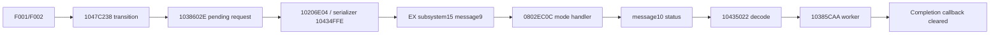

# Nikon Z6 II C1.70 research notes

Current evidence: 2026-11-22. This document describes offline analysis of a
specific firmware build. It is not an installation guide or a recovery procedure.
The research goals include more flexible in-camera color and custom looks,
investigating user-supplied 3D LUTs, and internal N-Log 10-bit recording. Color
and LUT work remains planned; internal N-Log 10-bit recording has **not** been
demonstrated. See the [research plans](../README.md#research-directions-and-contributions).
Higher bitrate, HDMI output depth, HDMI RAW activation and internal 10-bit
encoding are separate questions.

## Evidence conventions

- **Static:** decoded instructions, literals, initial data and call relationships.
- **Emulated:** original instructions executed with specified synthetic inputs
  and explicit stubs. This proves that isolated path under those assumptions.
- **Hardware-reported:** a third-party report, not independently reproduced here.
- **Inferred:** plausible interpretation, not established component identity.
- **Unverified:** a remaining gap; absence of a discovered write is not proof that
  no other path writes persistent state.

Function pointers have their Thumb bit set; instruction addresses below are even.
`LSLS x,#n` followed by a sign test examines original bit `31-n`. For example,
the `LSLS #0x12` in `0803C5C4` tests event `0x2000`, not `0x40000`.
Raw address matches and function-name strings alone are not control-flow evidence.

## Inputs, provenance and reproducibility

| Input | Size | SHA-256 | Load base |
| --- | ---: | --- | --- |
| Z6_2_0170.bin | 49002888 | `5a9640b4c07abe1ecbf5a52655cbec6b893bba045bb2a1a1d21055b9f8f9d06d` | Container |
| eg1850_mas_01700.bin | 38750138 | `bb83613121f843d65101da936d942acdc513d86dbd3abc26259d0d870d03f5d4` | `10020000` |
| eg1850_sla_01700.bin | 8832194 | `3fd8c2cbdf57fadb03f6d69b596b58a8703efdd61ae82572d5afeea0241a9ed5` | `10020000` |
| ex1850_012000.bi.bin | 524290 | `9c65cad554ed02f83d37fbc825a8eb9efe79e3f32f98894dd5dd73edee416983` | `08000000` |

All five module CRCs and the C1.70 container CRC passed. The original firmware
is not distributed. Other module metadata is in
[modules.json](../work/analysis/modules.json). EX reset vectors are
SP=`20000C08`, reset=`080002B5`; the footer includes version `01.20.00`.

[Pinned source metadata](../work/vendor/sources.json) identifies the reviewed
WonderLantern primitives used for local extraction. Recovery used zero/FF padding
observations, frequency inference for five missing indices, published table
fingerprints, and CRC validation. This is not a signature bypass or an updater test.
No modified update image has been produced.

`ExFirmware.initial_ram()` executes the seven original scatter-load copy,
decompression and zeroing routines from the table `080038CC..0800393C`.
In particular, initialized EX data is compressed; simply copying the ROM bytes
at `08051BA4` does not reproduce initialized RAM. The resulting RAM digest is
recorded by the EX scripts. The inspection helpers enforce input hashes.

### Executable checks

| Script | Scope / checks | Explicit exclusions |
| --- | --- | --- |
| [analyze_bitrate.py](../scripts/analyze_bitrate.py) | 204 selectors + 60 parameter-pipeline cases | Sensor, codec hardware, actual SPS, card recording, heat/stability |
| [analyze_ptp.py](../scripts/analyze_ptp.py) | Eight outer tables, 175 subcommands, four gate cases, identity branch, eight address filters, two memory transfers, ten video getter cases | USB, full boot, physical capability sources; optional local device snapshot is off by default |
| [analyze_service_recovery.py](../scripts/analyze_service_recovery.py) | Ten transition cases + six F002 cases | Low-level cleanup hardware and physical recovery |
| [analyze_config_read.py](../scripts/analyze_config_read.py) | Nine preflight, five read, two commit-dispatch, two packet cases | Real region descriptor, USB and physical NVRAM commit |
| [analyze_ex_service.py](../scripts/analyze_ex_service.py) | 14 EX/master exchange cases | Callback side effects, scheduler and actual transport |
| [analyze_ex_peripherals.py](../scripts/analyze_ex_peripherals.py) | Nine region1 cases, eight charger fault-predicate cases, three isolated region6 cases | Real I²C, GPIO, timer clocks, device power-on reset |

JSON outputs are under [work/analysis](../work/analysis). Counts describe cases,
not independent proofs of whole-camera safety. Some cases deliberately inject
failure. A passing assertion can confirm a problematic behavior.

## Internal video and bitrate

The master/slave bitrate tables are byte-identical: 34 records, 32 bytes each.

| Item | Master | Slave |
| --- | --- | --- |
| Table | `1091D594` | `101DCB08` |
| Selector | `10523D08` | `101089F4` |
| Getter | `10523E0A` | `10108AF6` |
| Encoder constructor | `104BE39A` | `100A2322` |
| Level threshold literal | `104BE72C` | `100A26B4` |

Maximum/average bitrate fields are at record offsets `+14/+18` hexadecimal.
4K 30/25/24p High uses rows 4/6/8. The first 28 bytes of Z6 II records 4–33
match the 30-record Z30 C1.20 table, whose stride is 28. Z6 II has an extra field
and two processor modules; the Z30 patch is not directly transferable.

| Configuration | Maximum / target average, Mbps | Selected Level parameter |
| --- | --- | --- |
| Stock | 144 / 120 | 51, corresponding to 5.1 |
| Candidate evaluated in emulator RAM | 156 / 140 | 51 |
| Z30 analogy | 200 / 168 | 61, corresponding to 6.1 |

The original code shifts bitrate by ten bits. Its threshold is `156250`, so
the 4K branch selects Level 61 at a maximum of at least 160,000,000 bit/s.
These are configuration values, not measurements from video. The 4K 50/60p
branch halves its 360/300 values before configuring a separate encoder;
it was preserved in all evaluated candidates.

Versions 1.02, 1.10, 1.60, 1.62 and 1.70 passed container/module CRC checks.
Their ten EG-module tables and threshold values matched. See
[version_comparison.json](../work/analysis/version_comparison.json).
Windows EXE packages were read as RAR SFX archives, not executed.

### HDMI-related state is not internal 10-bit support

Original getter execution establishes these mappings:

| PTP property | Internal source | Mapping |
| --- | --- | --- |
| `D0BF` | `126E`, `12A4` | `0/0→0`, `1/0→1`, `0/1→2` |
| `D0CC` | `126D` | Internal `0→PTP1` (HDMI 10-bit), `1→PTP0` (8-bit) |
| `D0BB` | `1688`, `16BF` | Returns one if either flag is one |

The unresolved video task is tracing these settings through ISP output format,
encoder input/format negotiation and the internal recording pipeline. No
internal 10-bit stream, N-Log card recording, or applicable codec patch is proven.

### AVC configuration, SPS templates and derived video state

The next offline pass is reproducible with
[`analyze_video_path.py`](../scripts/analyze_video_path.py); its captured results
are in [`video_path.json`](../work/analysis/video_path.json). The findings below
separate instruction execution, bitstream syntax and hardware interpretation.

**Configuration to register writer, emulated:** master constructor fragment
`104BE3B8..104BE5C0` and slave `100A2340..100A2548` were run with six controlled
input sets each: three 4K bitrate configurations and three synthetic FHD/HD
cases. The profile-like byte at config `+60` remains **100**, while the already
known Level byte at `+61` changes independently. The inspected profile and
candidate depth fields therefore stay constant across these bitrate cases.

The writer prefixes `104BE748..104BE976` / `100A26D0..100A28FE` forward the
configuration to intercepted register-write calls. Static tracing of the
master primitive `104D9AE8 → 1051F25A` fixes its hardware base at `24070000`.
No writes were delivered to hardware. Reviewed constructor fields start with
`A5` markers, so assertions about zero values check actual initialization;
other synthetic configuration fields start zero. The two modules give identical
captured results for all twelve input cases and ten packing-marker cases.

| Configuration | Observed packing | Interpretation boundary |
| --- | --- | --- |
| `+60:u8=100`, six words `+48..5C=0` | register `E30`, low byte and bits 8–13 | Strong match to AVC profile_idc and constraint flags, supported by the SPS below; hardware register names are inferred. |
| `+61:u8` | `E34` | Existing Level selection remains separate from profile/depth. |
| `+70:u32=0`, `+74:u32=1`, `+78/+79:u8=0/0` | `E48 = (word70<<15) \| (word74<<10) \| ((byte78&31)<<5) \| (byte79&31)`; result `400` hex | The last three fields strongly resemble chroma format and luma/chroma depth-minus8. Actual hardware interpretation and accepted formats remain unproved. |
| `+F=5`, `+10:u32=1`, `+14/15/16=1/1/1` | inspected writer produces `E68=3701`, `E6C=0101` hex | Consistent with VUI fields; stream metadata is not proof of a pixel transform or color accuracy. |

Markers in bytes `78/79` confirm independent five-bit packing, including masking
of higher bits. They do not test 10-bit encoding. Bytes `7A..7F` go to other
registers and are **not** all labeled bit depth. Likewise config `+8`, which can
be 0 or 2, is not established as an 8/10-bit input-format selector.

**SPS templates, selected and parsed:** the real selector `104A441E` chooses
three embedded SPS/PPS pairs. Parsing their AVC syntax establishes
profile_idc 100 (High), chroma_format_idc 1 (4:2:0), and both depth-minus8 values 0
(8-bit). Each describes coded 1920×1088 cropped to 1920×1080, with Level 51 (5.1).
VUI signals full-range 1 and primaries/transfer/matrix values 1/1/1. Timing pairs
are `(1001,60000)`, `(1,50)`, `(1001,48000)`.
Syntax reference: [ITU-T H.264, §7.3.2.1.1 and Annexes A/E](https://www.itu.int/rec/dologin_pub.asp?id=T-REC-H.264-202408-I%21%21PDF-E&lang=e&type=items).

| Settings index | SPS address / length | PPS address / length |
| --- | --- | --- |
| 7 | `108ABFE4` / 24 | `108ABFD8` / 4 |
| 8 | `108ABFFC` / 25 | `108ABFDC` / 4 |
| 9 | `108AC015` / 24 | `108ABFE0` / 4 |

These are **not universal headers for every video mode**. Static tracing of
`104A7C60` shows it first taking the supplied headers, then replacing them only
in the examined branch with settings `[66]==1` and `[67]` in 7/8/9, through
`104A7D02 → 104A5218 → 104A441E`. Copies occur at `104A7D0C/104A7D16`.
The selector was emulated for all three entries plus an invalid-index no-write
case; the enclosing recording pipeline and actual video output were not run.
The bounded parser stops after VUI timing and is not a full conformance checker.

**Derived video-state callbacks, emulated:** `1033A8B6` queues property `1688`;
`1033A98C` queues `16BF`. These are the two flags read by the existing D0BB getter.
Their records at `11906FA0/11906FB8` are associated with `126E/12A4`. Thirty synthetic
callback cases exercise gate/override behavior, unchanged-value suppression,
and a queue-failure result. A nonzero byte at argument offset `C` suppresses the
ordinary value in both callbacks; the first has an override and the second a
veto. The first argument word being 1 and the computed value equaling word 2
suppresses queueing. Queue failure still leaves the inspected change marker
set, so that marker alone does not establish successful application.

Upstream argument construction and the asynchronous consumers are not modeled.
The gate is deliberately **not** identified as a particular HDMI, sensor or
recording condition. These callbacks establish separate derived state, not a
working internal N-Log switch.

The remaining decisive work is the ISP output/pixel-buffer format, how the
actual encoder accepts that input, and where the N-Log transfer is applied.
Changing SPS/VUI labels or a menu guard would not prove those capabilities.
The [Nikon guide](https://nps.nikonimaging.com/technical_info/technical_solutions/z7_2_z6_2_tips/filming_n-log_footage/)
documents external HDMI N-Log; the new offline evidence does not extend that
claim to internal recording, nor prove that an extension is impossible.

### Frame descriptors at the AVC driver input

The C1.70 master passes two independently supplied addresses per frame entry
to the AVC driver. The driver setup also reserves two address slots spaced
12,441,600 bytes apart for 3840 × 2160. This spacing equals the footprint of a
tightly packed 8-bit 4:2:0 frame. The roles of those two slots (for example,
input or reference surfaces) remain open. They form a separate register pair
from the two addresses per frame entry described below.

**Frame submission.** The caller at `10488CEC` copies a 28-byte source
record into a 32-byte queue entry and submits it at `10488D06`. On the
consumer side, `10488228` copies that entry to the stack. Starting at
`10488238`, the adapter builds a 20-byte record. It checks that the two
16-bit pitch-like fields (source offsets 2 and 4) match and that the field at
offset 10 fits within each. It adds the same 16-bit displacement at offset 14
to the two independent bases at offsets 20 and 24. These source offsets are
decimal. The adapter and its checks were executed with synthetic entries.

The ring (`104A50EA` / `104A518C`) carries the 20-byte records to
`104A46E6`. The normal path groups three records, calculates
`(rows × pitch × 3) >> 1` for each, and supplies a size and two addresses
per record to descriptor builder `104D9CC4`. Here “rows” names the field at
source offset 12. “Pitch” names one of the equal fields tested by the adapter.
These names describe their arithmetic role. The code at `104BEE26` passes
each address to register offset `0x43C` after selecting its index via
`0x438`. In the checks, the pair for each input was recovered in order,
including after a ring wrap and the three-record reorder selected by group
field 3.

| Controlled case | Rows × pitch in synthetic descriptor | Computed size | Distance between setup slots |
| --- | --- | ---: | ---: |
| 3840 × 2160 | 2160 × 3840 | 12,441,600 | 12,441,600 |
| 1920 × 1080 | 1080 × 1920 | 3,110,400 | 3,133,440 |
| 1280 × 720 | 720 × 1280 | 1,382,400 | 3,133,440 |
| 1920 × 1080, padded input | 1080 × 2048 | 3,317,760 | — |

**Setup slots.** In `104A4CD0` the firmware selects the encoder dimensions
and populates two addresses from a common base before calling `104BE682`.
Following the stored pointer into writer fragment `104BEF12..104BEF2A`
produces register offsets `0x404` and `0x408`. The FHD and HD setups share
the same spacing, numerically equal to 1920 × 1088 × 3/2. Using that spacing
alone to infer an active frame format would give a misleading result for HD.

[Reproduce the nine cases](../scripts/analyze_frame_input.py) with the
original master image. Four submission batches of three records, three setup
families, and two rejected geometries exercise the paths above. The harness
replaces memory-copy/clear routines, synchronization, allocation, active-bank
lookup and register writes. During slot setup it captures the geometry passed
to the encoder configuration constructor. Pixel memory is left unmapped.
The producer of the values inside the original 28-byte record is traced in
the two-version comparison below. Component order and placement of the N-Log
transform remain unresolved.
Three static upstream submission call sites are `1026B232`, `102C940C` and
`102C944A`, each passing a record starting at offset `0x18` in an upstream
object.

### Who supplies the 4K frame planes

Both stock EG masters build a pair of plane addresses within one frame allocation
on the traced pooled route. Selector 2 reads **3840 × 2160** from each build's
own ROM dimensions table. Selectors 0 and 1 read 1280 × 720 and 1920 × 1080.
The 4K pool has **13,028,352 bytes per slot**. A full uncompressed 10-bit
4:2:0 picture needs at least **15,552,000 bytes** (3840 × 2160 × 1.5 × 10/8),
before padding. A P010 frame needs 24,883,200 bytes. Both exceed that slot.
This bound applies to the data crossing this particular interface.

| 4K constructor result | Pooled object, tag 2 | General object, family 1, tag 1 |
| --- | ---: | ---: |
| Active width × height | 3840 × 2160 | 3840 × 2160 |
| Both pitch fields, storage rows | 3984, 2176 | 3840, 2176 |
| Second plane base minus first (bytes) | 8,685,312 | 8,355,840 |
| Initial horizontal displacement | 128 | 0 |
| Span returned by the tag-dependent size calculation (bytes) | 13,019,904 | 16,711,680 |
| Capacity established from the pool setup (bytes) | 13,028,352 | Unknown |

The pooled constructor aligns the first base to 512 bytes. It puts the second
plane at `align256(first + pitch × (storage_rows + 4))`. The tag-dependent
size calculation adds half a plane for tag 2 and a whole plane for tag 1.
For the general case the first plane occupies `3840 × 2176` bytes. Even
active luma alone at ten independent bits per pixel needs 10,368,000 bytes,
which exceeds **both** inter-plane distances. The general case's larger
total span does not change that first-plane bound. These sizes fit ordinary
8-bit luma with 4:2:0-like or 4:2:2-like storage respectively. Component
ordering, interpretation of every format bit and pixel values are unmeasured.

| Role in the master | C1.62 | C1.70 |
| --- | --- | --- |
| Pool setup / indexed slot lookup | `103090B8` / `1029A1AA` | `103098F0` / `1029A3D6` |
| Pooled frame constructor / general constructor | `10308FE4` / `103044C4` | `1030981C` / `10304CFC` |
| Job 0x10 builder / address serializer | `102B8818` / `102BF006` | `102B8BCC` / `102BF3BA` |
| Job worker / handler for message `42193009` | `103B3820` / `103B369A` | `103B457C` / `103B43F6` |
| Per-port dispatch / channel register writer | `103BE9DA` / `103BF3AE` | `103BF776` / `103C014A` |
| Submit calls for context fields `+A8`, `+408`, `+440` | `1026B0F6`, `102C9058`, `102C9096` | `1026B232`, `102C940C`, `102C944A` |

**From the buffer pool to the image-processing job.** In C1.70, the
`+A8` pool registration at `10264430..1026443E` and the `+440` pool
initializer at `102CDB2A` both reach `103099F2 → 1030981C`. The pool
objects are later obtained through `102CE4AC`. One source for `+408` is
`103054C8 → 10304CFC`. These links are static. Other code can replace
the object in `+408`.

For `+440`, the caller at `102C73D0` takes its input from a copy of
the `+408` object and assigns `+440` to one of two job outputs. It clears
the destination displacement, dispatches job `0x10`, waits on a completion
event and sets the object's flag at `+14`. In a separate branch at
`102C8706`, `+408` itself becomes the first job output. The job builder
serializes both plane bases for its selected destination. The worker receives
an 18-entry job through message `42193009`. In the initialized table, entries
0, 9 and 17 reference the input and the two output descriptions. The channel
writer transfers both pitches to bank offsets `+10/+14`, active dimensions to
`+20`, and plane bases to `+24/+28`. The following two address words are
zero in the tested cases. All register offsets here are hexadecimal.

**What ran.** The [two-build reproducer](../scripts/analyze_frame_producer.py)
rejects unexpected master hashes. It runs the original constructors, slot
arithmetic (including wraparound), selected job routing, the complete job
builder with a synthetic tile configuration, worker case selection, port
serialization, and the three submission handlers up to their common queue
and AVC adapter. The CPU executes these as
bounded fragments. Mode and gate inputs, allocator base, tile setup and
channel assignment are fixtures. The job table starts from each ROM's own
scatter-load data. Clear/copy helpers are modeled, address translation uses
an identity fixture and register writes land in emulator RAM. Channels 3 and
12 exercise the port writer. For tags 2 and 1 it emits control words
`09000201` and `09000001` respectively in these cases. The physical channel
assignment and the hardware meaning of bit 9 remain open. Pixel memory stays
unmapped throughout.

Run `python scripts/analyze_frame_producer.py` with the local C1.62 package
and the extraction setup described in the README, or pass the extracted
`eg1850_mas_0162a` as the positional argument. The C1.70 input defaults to
the same master as the earlier frame-input trace. The script prints both
sets of measurements and checks them for equality.

The strongest current conclusion is that ordinary full-precision linear
10-bit planes cannot fit the examined 4K layouts. The code identifies the
software job that configures the writes. The actual bus master, sample
precision earlier in the ISP, proprietary packing or extra surfaces, and
the active route for every 4K frame rate still need independent evidence.
The following comparison resolves a shared processing job and follows its
HDMI and pooled card surfaces to their respective consumers.

### Where HDMI and card recording diverge in 4K

**Result for C1.62 and C1.70.** Both original EG masters select the same
layouts and routing for the tested 3840 × 2160 configuration. With HDMI 10-bit
and N-Log selected, the common image-processing job describes a wide input
and a wide HDMI destination. Its card destination already has too few bytes
per line for ordinary, uncompressed 10-bit luma. The same card plane addresses
reach the AVC input adapter. This places the precision bound at or before the
write to the card surface. The instructions examined describe buffers and
configure processing. The numerical operation that produces their samples
remains unknown.

| Surface | Firmware fields `YCbCrFormat, DataFormat` | Y / C bytes per line | `AddressC − AddressY` | Y / C addresses in one emulated allocation |
| --- | --- | --- | ---: | --- |
| Shared source, 4030 × 2266 | `1, 2` | 6048 / 6048 | 13,704,768 | `60000200 / 60D12040` |
| HDMI 4K, 10-bit with N-Log | `1, 2` | 5760 / 5760 | 13,045,248 | `58000200 / 58C71000` |
| HDMI 4K, 8-bit control | `2, 0` | 3840 / 3840 | 13,045,248 | Same bases for the same allocation |
| Card 4K, pooled output | `2, 0` | 3984 / 3984 | 8,685,312 | `50C6CC00 / 514B5300` |

Addresses in the last column are hexadecimal fixture values. At runtime
each output gets its own allocation, with Y rounded up to a 512-byte boundary.
The gaps above recover C from Y. Both outputs describe 2176 storage rows and
2160 active rows. Nikon's own diagnostic code supplies the field names by
reading offsets `+0/+1`, `+2/+4` and `+14/+18` (hex) in a 28-byte record.
The experiment executes those reads up to the formatter. The equal HDMI
plane gap across depths shows why the gap alone cannot identify the format.

**Where the paths split.** The stock mode selector returns `0x17` for the
tested configuration, which maps to job `0x0A`. Its builder uses 28 entries
from the firmware's initialized table. Input entry 0 comes from context
`+94`, card entry 21 from `+A8` and HDMI entry 22 from `+A0`.
The following paths use logical node IDs in hex. The table indices above
are decimal.

| Destination | Directed links in the job table |
| --- | --- |
| HDMI | `01 → 02 → 03 → 05 → 07 → 09 → 0B → 0F → 14 → 17` |
| Card, first path | `01 → 02 → 03 → 05 → 0D → 10 → 15` |
| Card, second path | `01 → 02 → 04 → 06 → 0E → 11 → 15` |

Node `05` explicitly lists successors `0D` and `07`. The second card path
branches at `02`. The port parser resolves the last links to the card and
HDMI destinations and reads their assigned channels. The builder programs
width-minus-one values 3983, 3983 and 3839 at those three preceding ports.
The output enables are separately gated. This is the topology available to
the job. Simultaneous physical card recording and 10-bit HDMI output, and
the active path for each commercial frame-rate setting, remain unverified.

For independent inspection of the C1.70 pool assignments, `10264542..4E`
loads a source into `+94`, `1026447A..84` supplies `+A0` and
`102645A8..B2` supplies `+A8`. The reproducer supplies separately allocated
objects at those fields, then runs the stock snapshot, job dispatch and
builder. The mode fixture sets context byte 0 to 1, bit 2 at `+AC`, and
the three bytes at `+4D4` to `02 02 04`.

**Following the outputs.** For the ordinary depth callback inputs, property
`126D` publishes effective depth `16A5`, and the snapshot places it at
`+46C` in the mode context. The curve flags occupy separate bytes. Changing
N-Log or HLG at fixed depth left the measured surface layout unchanged.
In HDMI output 1, modes 2 and 3 carry both bases and tag 1 (10-bit)
or 4 (8-bit) through the ring and into the display driver. With zero crop,
the driver writes the same Y/C addresses to bank offsets `+210/+220` and
the same pitches to `+240/+250`. Nonzero crop exercises a further difference.
At origin (2, 3), tag 1 advances both bases by 17,283 bytes. Tag 4 advances
Y by 11,522 and C by 3,842 bytes. These are offsets within a modeled register
bank with base `20140000` and a zero driver displacement.

For the card object in this job, submission through `+A8` carries both
bases plus its 128-byte displacement, with both pitches still 3984. A row
of 3840 independent 10-bit luma samples needs at least 4800 bytes. The wide
HDMI stride establishes storage capacity. Its precise bit packing, the
significance of the low bits, and the location of the N-Log transfer require
separate evidence. No pixel values were observed.

| Reproduction landmarks (EG master) | C1.62 | C1.70 |
| --- | --- | --- |
| Depth callback / snapshot depth read | `10339EDE` / `103548F4` | `1033A852` / `10355830` |
| Shared input / HDMI surface constructor | `10307E58` / `103086A2` | `10308690` / `10308EDA` |
| Mode selector / mode-to-job map | `103150B8` / `10264826` | `10315A2C` / `10264962` |
| Job dispatcher / builder | `102BB0A8` / `102B9AEE` | `102BB45C` / `102B9EA2` |
| Port parser / node ID resolver | `103B55AC` / `103B615C` | `103B6308` / `103B6EB8` |
| HDMI packet builder / lower display driver | `1026A446` / `104D98AA` | `1026A582` / `104DD19A` |
| Card submit call / AVC input adapter | `1026B0F6` / `10487368` | `1026B232` / `10488238` |

Run `python scripts/compare_hdmi_card.py` with the same local images as the
frame-producer experiment. The script verifies both master hashes, runs
bounded Thumb routines and compares the resulting records for equality.
Allocation bases, ordinary property inputs, job enables, synchronization
and register banks are modeled. The ring stores and retrieves the actual
emulated payload. Pixel memory stays unmapped. The JSON printed to stdout
includes plane addresses, node paths and control runs.
[Two-build reproducer](../scripts/compare_hdmi_card.py)

### Card movie baseline and N-Log research priorities

Two independently downloadable samples from [Optyczne's Z6 II recording test](https://www.optyczne.pl/42.5-Inne_testy-Nikon_Z6_II_-_test_trybu_filmowego_Podsumowanie_i_filmy_przyk%C5%82adowe.html)
supply an output baseline. The first 6 MiB of each MOV contained the movie
metadata and AVC parameter sets. Both prefixes contained the strings
`NIKON Z 6_2` and `Ver.01.01`. The firmware layout comparison uses C1.62 and C1.70.

| Published original | Video track (ffprobe) | AVC sequence header | SHA-256 of bytes 0–6291455 |
| --- | --- | --- | --- |
| [Film 4](https://pliki.optyczne.pl/NZ62/filmy_przykladowe/NZ62_-_film4.MOV), FX | 3840 × 2160, 25 fps, 120.36 Mb/s | High, level 5.1, 8-bit 4:2:0 | `5c2b1827320a2b691c5da0bb43b6a9505f678030661fb591fe819a8c3b312fd6` |
| [Film 7](https://pliki.optyczne.pl/NZ62/filmy_przykladowe/NZ62_-_film7.MOV), DX | 1920 × 1080, 25 fps, 12.38 Mb/s | High, level 4.1, 8-bit 4:2:0 | `c0acd5a7439fc3f4b94de67fbfa36e8f729bd235c37938dcbf220904d7756566` |

Bitrates are track averages reported by the container. Both tracks signal
full range and BT.709 primaries, transfer and matrix. On each prefix,
`ffmpeg -i prefix.mov -map 0:v:0 -c copy -frames:v 1 -bsf:v trace_headers -f null -`
independently exposes profile 100, chroma format 1 and both depth-minus-eight fields
set to zero. These observations establish stream syntax. Scene response, sensor
precision and actual range use would require pixel measurements.

**What the paid products provide.** Nikon's service adds an HDMI menu entry for
12-bit RAW output to a compatible external recorder. The recorder determines
whether the resulting file is ProRes RAW or Blackmagic RAW. Nikon documents
10-bit N-Log over HDMI separately. EOSHD advertises Z-LOG as a paid image
profile loaded from a memory card and lists Z6 II compatibility. The vendor
description establishes its advertised use. Its curve and its footage have
yet to be independently evaluated here.
[Nikon RAW guide](https://download.nikonimglib.com/archive4/ALaFi009bHw404g9Wx085U74N168/Z7IIZ6II_TG_RAW_%28Ru%2904.pdf) ·
[Nikon N-Log recording guide](https://nps.nikonimaging.com/technical_info/technical_solutions/z7_2_z6_2_tips/filming_n-log_footage/) ·
[EOSHD product description](https://www.eoshd.com/eoshd-z-log-nikon-z6-z7-d850/).

**Curve reference.** Nikon's forward transfer function gives nearest-integer
10-bit codes 127, 372, 603 and 619 for reflectances 0, 0.18, 0.90 and 1.00.
These are scene-referred reference values before any video-range rescaling.
The [comparison script](../scripts/check_nlog_tables.py) looks for exact full
tables in the hash-verified C1.70 master and slave images. It tests 256, 1024
and 4096 samples, linear input domains ending at 1 or 8, endpoint-inclusive
or endpoint-exclusive grids, nearest or floor rounding, and 16-bit
little-endian storage with output shifts 0 or 6. All 48 representations per
image returned zero complete matches. An unaligned positive control and a
one-word mutation check the search. Coefficients, interpolation, other grids,
vendor-specific packing and ISP-resident curves remain open.
[Nikon N-Log specification, section 2](https://download.nikonimglib.com/archive4/zMDhS00ZuoyY0502OFd16BeF1X67/N-Log_Specification_%28En%2901.pdf).

**Order of investigation**

1. Map each 4K frame-rate setting to a job and its enabled outputs. For the
   [verified job 0x0A](#where-hdmi-and-card-recording-diverge-in-4k), decode
   the processing controls on the branches from nodes `02` and `05` through
   the writers for card node `15`. Look for evidence that distinguishes
   sample conversion, transfer-curve selection and final memory packing.
2. Follow the documented HDMI N-Log state to the ISP configuration that
   selects a curve or coefficients. Compare with the card path at the last
   shared processing stage. A candidate should match several reference
   exposures across both branches of Nikon's curve and have a justified input
   scale and output range.
3. Test whether the AVC input and output modes can both carry more than eight
   significant bits. An offline routing trace can establish a candidate.
   A convincing eventual recording would need a card file with 10-bit
   sequence headers and a controlled gradient/exposure series consistent
   with retained precision and the N-Log curve. An existing original
   C1.70 clip would already help validate the stock baseline.
4. Track the board identification independently using an attributable macro
   with board revision and a readable package marking. Board images address
   the power/recovery question. Recovery after interruption remains open.

## Service dispatcher and memory/configuration reads

Outer table `119F2784` includes `94FD/94FE/94FF`. Their first PTP parameter
selects a subcommand in `119F496C` (175 entries). These are not 175 advertised
GetDeviceInfo operations. General guard `104C966C` calls `1047C205`, which
reads RAM flag `C188BC40`. With the gate closed, examined F003/F032 requests
return `A004`. F001 is the exception used to enter service state.

| Path | Addresses | Meaning / limit |
| --- | --- | --- |
| F003/1 | Dispatch covered by PTP script | Returns a fixed padded model string, not a memory dump |
| F032 | Preflight `104B5386`, filter `104B5314`, executor `104B5488` | Address/length from PTP parameters 2/3; source passed to `1063F682` or copying path `104B53C6` |
| Dynamic region8 | Descriptor `C185EC88`, getter `103A6C64` | Boot-image address/length are zero; runtime descriptor is not established by that image |
| Video cache | `C188C060` | PTP property cache, not an image/encoder buffer |
| F02D | Preflight `104B4EC8`, executor `104B4F1A` | Copies region8 into a transfer buffer, masks bytes4/5, sends requested range |
| F030 | Executor `104B517A` → `104B48C6(8)` | Separate save/commit request; physical commit not emulated |

F032 has denied ranges including `10000000–13FFFFFF`, `C1000000–C17FFFFF`,
`C2B90000–C2B9105B`, `CC200000–CCAFFFFF`, and a dynamic region. The emulator's
synthetic descriptors do not authorize or predict reads of arbitrary hardware.

For F02D, the tested region size `0x1FFFC` is synthetic and agrees with the
examined backend/third-party report; it is not a current camera dump. Masking
uses original field offsets for IDs12/14 via `103C31E4`. The source region is
read-only in tests. The executor uses the shared USB buffer returned by
`1063F598`, not a fresh allocation per request; `1063F5AC` returns `0x1FFFF8`.

Two findings matter for any future client:

1. The preflight adds offset+length in 32 bits and accepts a tested overflow
   example. Only that preflight was exercised; its executor was not run.
   Client bounds must be checked without overflow.
2. Outer `2001` can contain nested `2007` for a transfer failure, or `A001`
   for an unavailable region. Check the nested result and actual data length.

The masked configuration result is not a full backup or a proven restore image.
No arbitrary memory-write or activation client is included here.

## Entry, exit and response-loss behavior

F001 handler `1047C278` calls `10505A4A(0)`, region preparation `104B6C10`,
`104939C6` (whose examined target `10376D0E` is a no-op), and transition
helper `1047C238(0)`. It sets `C188BC40=1` only if that helper succeeds.
All preparatory effects have not been exhausted.

F002 `1047C392` calls cleanup `1047C322`. While active, cleanup calls
`1047C238(1)` but ignores its result, clears `C188BC40/C188BC48`, and returns
success. Four injected lower-transition failures reproduce outer and nested
`2001` despite failure below. This is a confirmed weakness in success reporting,
not a claim that real cameras necessarily become stuck. Other cleanup routines
may contribute recovery and have not been fully traced.

PTP CloseSession `1003` reaches `1047C1BC → 1047B51E → 1047C322`, the same
cleanup. It is not an independent fallback. Additional cleanup callers around
`104665A4/10466640/10466666/1046667C` are not yet tied to physical USB removal.
Wait argument `0x7D0` is known, but its time unit has not been established.

### Master → EX message

Startup table `11990924`, row15 at `11990A14`, registers `102054FF` through
`10206CBA`. The path is `10206E04 → 102054FE → 10434E6C → 10434FFE → 10205698`.

| Mode | Eight-byte payload |
| --- | --- |
| Entry, mode0 | `09 00 00 00 00 00 00 00` |
| Exit, mode1 | `09 00 00 00 01 00 00 00` |

Internal queue channel1 becomes wire channel2. `102054EE/1020545C` supplies
subsystem15 and length8. Queue `ExCmdQuD` has vtable `C1887A78`;
`ExPrtTxE` worker `1020B7E8` reaches `10372B6C → 10372EEA → 1024321C`.
`1020BDB6` forms the packet, `1020BD96` participates in checksum calculation.
Transport retries/error counters do not establish rollback of a command.

### EX receiver

`08031D34` registers the 18-row table `2000D32C`. Row15 contains setter
`0802EC9D` and receiver `0802F96D`. Reply function is `08032000`.
Packet receiver `08031E70` validates header/channel/length and forwards
the eight-byte payload to `0802F96C`. Message9 stores the mode at `20014070`
and signals event `0x20`; worker `0802F484` calls `0802EC0C`.

The region table at `2000E79C` has nine 20-byte descriptors:

| ID | Flash source | Working RAM | Length | Refreshed on entry |
| --- | --- | --- | ---: | --- |
| 0 | `08004000` | `20038000` | 3628 | Parent range |
| 1 | `08004010` | `20038010` | 3608 | Yes |
| 2 | `08008000` | `20038E2C` | 4540 | Parent range |
| 3 | `08008010` | `20038E3C` | 240 | Yes |
| 4 | `08008100` | `20038F2C` | 512 | Yes |
| 5 | `08008300` | `2003912C` | 64 | Yes |
| 6 | `08008340` | `2003916C` | 3704 | Yes |
| 7 | `0800C000` | `20039FE8` | 24 | Parent range |
| 8 | `0800C010` | `20039FF8` | 4 | Yes |

Mode0 compares eligible slices and copies differing flash bytes into working
RAM, then `0802F43C` notifies only changed regions. Parent ranges overlap
their child slices; the tests check both direct copies and overlapping views.
The update image's calibration/default sectors are not a dump of the unit's
actual configuration. Mode1 skips this refresh/notification branch.

Both modes form `0A 00 00 00 00 00 00 00` (message10/status0). No persistent
service-state bit occurs in this specific handler. A separate command7 path
uses event `0x10 → 0802F57C → 08032120` to request saving. That distinction
does not rule out persistent effects inside unidentified peripheral devices.

`0802FB80` retries reply insertion while the queue returns `FFFF`, sleeping1
between attempts, without a local iteration limit. Queue acceptance is not
physical delivery. The handler does not roll back refreshed RAM if the reply
is lost. A repeated isolated EX entry leaves unchanged regions unnotified;
this is not proof that a PTP retry will reach EX.

### EX → master acknowledgment

`10434EB4 → 10435022` decodes wire message10 to internal code `0x12`,
normalizes status into `C188736A`, and routes through `10206CC4` to callback
`10385A94`. It stores status at `C18A7B7E` and signals event `0x80`.
Worker `10385CAA`, branch `10385DA4`, emits `03010003` for entry or
`03010004` for exit, calls `C18A7BA4`, then clears that pending callback.
Success is status zero.

Without a reply, `1038602E` rejects a new transition while that callback is
nonzero. A late valid response clears it and permits another low-level request.
This was emulated for both modes. Full PTP state and other cleanup are outside
that check. Initial master data sets the callback and service flag to zero;
`10385FC4` merely sets an interface pointer and is not pending-state cleanup.

## Peripheral side effects of entry

Callback table `2000D3C4` has six entries for regions6/5/1/4/3/1. No callback
is triggered if its region has not changed. Whole entry is therefore not
accurately described as a read-only operation.

### Region1: I²C register programming

`08024BB2 → 08029418` compares old `2001F737` with new region1+`0x117`.
A transition into5 calls builder `08028ED8` and programmer `0802B40C`;
out of5 uses `08028CF0` and `0802B234`. Writes use
`0802AE98 → 080449B0`, address `D6`, one-byte register addresses/data.
The corresponding 7-bit address is `6B`. The combined register fingerprint
strongly favors TI BQ25882, as detailed below; the address alone is insufficient.
There is also a GPIO-level operation through `0802B218`.

| Transition | Register order | Fixed bytes |
| --- | --- | --- |
| Into5 | `00,01,02,03,04,05,07,06` | `00=00`, `01=C0` |
| Out of5 | `06,00,01,02,03,04,05,07` | `00=A0`, `01=C0` |

Other fields are bitwise merges with the register shadow at `2001F59A`.
The out-of5 builder also preserves some descriptor fields. The exact
synthetic transactions are in [ex_peripherals.json](../work/analysis/ex_peripherals.json).
They must not be presented as captured camera calibration values.

`0802B014` writes and reads back registers00/01/03, with masks `FF/3F/1F`
and upper bounds `A0/18/19`. After three mismatches it writes `01=C0`.
In the tested path, transport success after this fallback can leave the
programmer's success status set despite mismatching readback. The test
models only read/write values, not the device's internal semantics.

Initializer `0802B170`, called at `08027256` and from error cleanup
`0802ACD4`, resets the ten-byte RAM shadow to
`00 80 A0 00 00 8D 33 00 CD 06`. It does not itself transmit those bytes.
`08024C70 → 080294B0` loads region1 with normalize=1; original callback
execution on that branch skips service-time peripheral programming.
These are software-initialization findings, not a complete boot proof.

### I²C0x6B identification: BQ25882 is the leading candidate

**Inferred identity, not a board-marking or live part-ID confirmation.** The
driver's register layout matches the TI BQ25882/BQ25883 charger family. A
variant-specific fault-bit test favors BQ25882. A shared driver or undocumented
compatible variant remains possible.

The following firmware evidence is independently reproducible from the EX hash
above. Field names are compared against TI's
[BQ25882 SLVSE40C](https://www.ti.com/lit/ds/symlink/bq25882.pdf)
([TI mirror](https://www.tij.co.jp/jp/lit/ds/symlink/bq25882.pdf)), §8.5:

| Firmware observation | Matching charger field |
| --- | --- |
| Register00, mask `FF`, bound `A0` | VREG[7:0] |
| Register01, mask `3F`, bound `18`; upper bits separately controlled | ICHG[5:0], EN_ILIM, EN_HIZ |
| Register03, mask `1F`, bound `19` | IINDPM[4:0] |
| Register04, two nibbles | IPRECHG / ITERM |
| Register06 bits 2/3 | BATLOWV / EN_CHG |
| Register07 bit 7 and low nibble | PFM_DIS / SYS_MIN |
| Read0B at `0802AD76`, result `&7` | CHRG_STAT |
| Read10 at `0802AE16`, result `>>7` | PG_FLAG (power-good event flag) |

The firmware limits are software policy, not necessarily chip maxima.
This is a multi-register match, reinforced by the driver living in task
`BatCmSvc` (`10010`, worker`08027E58`) and using object `BatCmFg3`.
Initialization runs through `08026620 → 080271F4 → 08027256 → 0802B170`.

The strongest discriminator is `0802AFA4` reading01 and `0802AFD4` reading11.
The tail `0802AFFA..0802B00C` tests bit7 of01, then bit3 of11 before storing
through its output pointer. Eight synthetic combinations execute these original
instructions, including adjacent-bit counterexamples. BQ25882 §8.5.18, printed
p54, calls REG11[3] `SYS_SHORT_FLAG`;
[BQ25883 SLUSDL3A](https://www.ti.com/lit/ds/symlink/bq25883.pdf), same section
and page, reserves it as zero. This favors BQ25882 without proving the exact
populated component.

The bounded driver search found five direct calls to read wrapper`0802AE48`:
registers0B/10/01/11 and dynamic readback. All six callers of readback helper
`0802B014` select00/01/03. No register25 read was found in that set; this does
not exclude every indirect path in EX. TI's REG25[6:3] identifies82 as`0010`
and83 as`0011` (§8.5.38, printed p67 in both reviewed revisions). No part-ID
read was sent to a camera.

**Board connections from static code:** index0 maps via`0804D998[0]=A0` to
descriptor`2000E45C`, I²C1 base`40005400`. Setup`08044ADC..08044B18` selects
PB8/PB9, AF4. GPIO resource40 maps to PE0 input;29 maps to PC9 output, set by
`0802B218`. Which charger pins these reach is unverified; naming them CE/PG
from functional resemblance would overstate the evidence.

The [board-photo comparison](BOARD_MAP.md) adds scale and surrounding-component
checks, plus an annotated viewer. It does **not** establish a physical BQ25882
location. In particular, PC9's observed polarity does not establish a direct
active-low CE connection, and PE0's three-state sample classifier does not
identify a charger pin. BQ25882 has no STAT pin. These are important limits on
using the firmware signals to label a photograph.

**Interpretation of the transition:** under the BQ25882 map, `01=C0` sets
EN_HIZ/EN_ILIM; it is not a nonvolatile-save or register-reset command.
`00=00/A0` corresponds to 6.80/8.40V limits, with charging separately gated.
These are register interpretations, not measured battery voltages.

Two additional cases execute the real RAM-shadow initializer before the
transition. Into5 produces `00:00 01:C0 02:A0 03:00 04:00 05:8D 07:80 06:33`.
The isolated out-of5 case produces
`06:33 00:A0 01:C0 02:A0 03:00 04:00 05:8D 07:00`. They start descriptor fields
at scatter-load defaults; the second is **not** an enter-then-exit session.
Other descriptor histories can change preserved fields. The earlier synthetic
shadow remains useful for testing bit preservation, but its bytes are not
camera defaults. Even the real initializer's shadow is a software policy:
for example its register00 shadow is00 while TI's reset value isA0.

### Charger power-on reset: documented condition, conditional board conclusion

TI documents register defaults after genuine POR, with internal bias supplied
from either BAT or VBUS. Thus loss of both sustaining supplies followed by
power restoration is the relevant condition. Disconnecting just one source
while the other sustains the IC does not establish POR. Watchdog expiry resets
selected fields; REG25's register-reset command is separate. See
[BQ25883 §8.3.1, §8.4.1 and §8.5.38](https://www.ti.com/lit/ds/symlink/bq25883.pdf);
the BQ25882 datasheet documents the same distinction.

The published experiments do not model power loss. For the leading candidate,
the inspected writes configure resettable control registers; there is no
EEPROM-program command in this sequence. Applying the datasheet conclusion to
Z6 II remains conditional on component identity and actual BAT/VBUS rail loss.
Camera OFF, cable removal and battery removal are user actions, not measurements
of those rails. No discharge time, complete-camera reset, or fault-recovery
guarantee has been established. Firmware may also reprogram the chip after POR.

### Region3: SPI2 commands and GPIO

`0802BBC0 → 0802E1B4 → event2 → 0802DB1C → 0802D824/0802DCE8`
validates and loads settings. `0802D7F4 → 0802DD0C` enqueues commands;
`0802D91C → 0802D8E4 → 08045894` transmits with DMA.

| Region offset, hex | Command byte | Data bytes | Accepted data range |
| --- | --- | ---: | --- |
| `20` | `04` | 1 | 0–4 or 8–12 |
| `24` | `0F` | 3 | Each byte 0–63 |
| `28` | `10` | 1 | 0–15 |
| `2C` | `1C` | 1 | 1–63 |
| `30` | `1D` | 3 | Each byte 0–63 |
| `34` | `1E` | 1 | 0–15 |

Command prefixes are checked too. Invalid input reaches diagnostic `0802146C`
and leaves the previous RAM entry. The update image's first `0x70` region3
bytes are zero and fail expected prefixes; those are not usable camera
calibrations. Initial table data includes `04→02`, `0F→000000`, `10→03`,
`1C→0D`, `1D→000000`, `1E→00`, before later initialization.

Resource `74 → descriptor2000E48C` gives SPI2 base `40003800`;
DMA resource `C6 → 2000D73C` gives `40026070`. `0802DC28` selects AF5
for PD3/PC3. PE8 is low for command and high for data; PA4 is low before
the command and high after data. PE14 is raised in `0802D554` and lowered
in shutdown `0802DE00`. D/C, chip-select and enable are behavioral
interpretations, not schematic net labels. Timer name `DspTpCy1` suggests
the top display, but the component identity remains unverified.

Subsystem descriptor `2000ED88` is exposed through registered getter
`0802DF94`. Init `0802DF9C → 0802E134` reobtains resources and clears
runtime pointers/counters. `0802E168` obtains region3, and `0802DA40`
clears 50 queue slots and rebuilds the full initialization sequence.
Worker event1 invokes setup `0802D554`. Shutdown clears the queue,
sends a closing command, lowers PE14 and disables/reconfigures GPIO/SPI/DMA.
No command7/EX flash commit was found in this inspected chain. External
NVM behavior cannot be excluded without the device's register specification.

### Region6: TIM2 period and deferred application

`08036730 → event40000 → 08036744 → 080361B6` prepares settings.
`080350CC` copies `0x42` bytes to `200175C4` and signals `0x80000` to
worker `08034DE0`, whose isolated branch `08035090` updates RAM.
Its shared tail can emit `03020001` when state3; later consumers are
not exhaustively traced.

The other branch, `08035FC0 → 0803C77C`, copies the same-size block to
`20018964`, signals `0x2000` on object `200188D8`, registered by `0803C030`
with worker `0803C5C5` (instruction address `0803C5C4`). For this isolated event:

- If `[2001887C+38] != 0`, set `[+44]=1` to defer application.
- Otherwise `0803C79C` copies settings to `20018922` and byte`+3A` to
  `20018718`. `08035400` writes **TIM2 ARR `4000002C`** and RAM cache
  `200187F4`.

The original integer arithmetic is
`ARR = floor(50,000,000 / floor(1,000,000 / rate)) - 1`.
Synthetic rate50 produces2499, rate60 produces2999. Neither input value nor
timer frequency was measured on hardware. The busy case performs no ARR write.

Timer identity comes from index2 via `08040370 → 0804DA90[2]=81`, registry
`08042360`, descriptor `2000E4FC=[81,2000F9C0,40000000,0]`, and
`080353C6` copying descriptor+8 to `200187E8`.
Initialization follows `080352E0 → 08036064 → 08035508 → 08035708 →
080353B4 → 080462CC → 080498F8`, rewriting CR1, PSC, ARR and EGR=1.
This is volatile MCU timer configuration with an explicit reinitialization
path, not a flash/EEPROM change in the examined branch.

### Remaining callbacks

Region4 reaches `080294F4(r1=0)`, updates RAM and copies `0x48` bytes via
`08024998`; its normalization branch is skipped. Region5 signals workers
`08030E34/08031A8C`; the isolated event copies word`200189C0→200189BC`.
The second region1 callback signals `0x80000` to `08036744`, whose
`0803616C` path reads offsets`11C/11E/392` and updates RAM flags.

## What power removal does and does not establish

| State | Established offline | Not established |
| --- | --- | --- |
| Master pending callback/service flag | Initial data initializes them to zero | All real reset paths execute that initialization successfully |
| EX RAM shadows/queues | Scatter-load and subsystem initializers rebuild/reset them | Real startup reaches all required states after a failed transaction |
| TIM2 ARR/PSC/control | MCU register state; explicit setup rewrites it | A particular user power action resets the intended physical domains |
| External I²C0xD6 | Exact sequences; BQ25882 favored by register/fault-bit match; TI documents POR for candidate family | Physical part identity, rail wiring and actual removal of sustaining power |
| External SPI2 target | Commands, control lines, startup/shutdown sequence | Chip identity, NVM effects, behavior of interrupted commands |
| Whole camera | No demonstrated persistent change in the inspected narrow paths | Guaranteed recovery by OFF/ON, unplugging USB, or battery removal |

[ST RM0402](https://www.st.com/resource/en/reference_manual/rm0402-stm32f412-advanced-armbased-32bit-mcus-stmicroelectronics.pdf)
distinguishes system, power and backup-domain resets; power reset excludes
the separately powered backup domain. This supports the need to distinguish
reset scopes, not a claim about Nikon's entire board.
[Nikon's manual](https://onlinemanual.nikonimglib.com/z7II_z6II/en/03_first_step_06.html)
documents an independent rechargeable clock battery. Its existence does not
prove it powers the inspected I²C/SPI devices. It does mean removing the main
battery is not proof that every supply inside the camera has disappeared.

The charger-family evidence narrows one uncertainty: its inspected settings
are resettable according to TI. The SPI target remains unidentified, and the
board's rail/reset routing remains unresolved. No assertion of guaranteed
whole-camera recovery follows.

## External reports and documentation

### Spare boards and repair photographs

Checked 2026-11-12. Photos can establish a populated part only when both the
camera/board attribution and the marking are readable. A seller's compatibility
title alone is weaker evidence. No published photo reviewed here confirms the
charger marking or its BAT/VBUS wiring.

| Source | Observed evidence and limits |
| --- | --- |
| [Z6 II mainboard listing](https://www.ebay.com/itm/318114192387), [side A](https://i.ebayimg.com/images/g/TAwAAeSwvlZp0-6~/s-l1600.webp), [side B](https://i.ebayimg.com/images/g/TtUAAeSwPHhp0-7A/s-l1600.webp) | Both sides at 1200×1600; Nikon EI-223 and STM32F412 markings are visible, with USB-C/HDMI connectors. No readable BQ25882/83 marking. Attribution is the seller's, not a documented extraction from a camera. A possible silk sequence `2136 14-01 A7` is not established as a service part number. |
| [Additional Z6 II mainboard, ended listing](https://www.ebay.com/itm/287100787170), [SD side](https://i.ebayimg.com/images/g/hsgAAeSw2zNo9fJx/s-l1600.webp), [USB-C side](https://i.ebayimg.com/images/g/t5cAAeSwdDVo9fJw/s-l1600.webp) | Additional unobstructed views, 1600×1147 and 1600×1024. The board occupies most of the image width. Inspected the USB-C-side small ICs at native resolution using an unenhanced crop; no reliable BQ25882/83 transcription. A request for the USB-C image as `s-l9600.jpg` returned an 80×80 placeholder, not a higher-resolution original. |
| [AliExpress 1005010161490916](https://aliexpress.ru/item/1005010161490916.html), [international card](https://www.aliexpress.com/item/1005010161490916.html) | User-supplied source, reviewed 2026-11-12. The international page's `imagePathList` supplied five unsuffixed JPEG originals: all decoded as **800×800**. Two SD-side views and three USB-side views, including an additional straight-on USB photograph. Watermark: Camera Parts Global Store; cover labels Z6 II. No readable BQ25882 marking; P1/P2 remain unresolved. Native URLs, hashes and rectangles are in the [board viewer](board-map.html); see [comparison details](BOARD_MAP.md#aliexpress-gallery-originals). |
| [Z6 II/Z7 II DC board, deda-6067](https://www.ebay.com/itm/394657347050), [component side](https://i.ebayimg.com/images/g/RSwAAOSwtUFkebIS/s-l1600.jpg), [contact side](https://i.ebayimg.com/images/g/OpkAAOSwfRBkebIV/s-l1600.webp) | Both actual images are 1000×1000 despite the URL size. The board occupies roughly 400 pixels, with a HAGEZA watermark and a label covering components on the contact side. Useful layout views, insufficient for the charger marking. The photos themselves are labeled Z6 II / DC PCB; compatibility remains seller-attributed. |
| [Alibaba Z6 II motherboard](https://www.alibaba.com/product-detail/New-Original-for-Z6-II-Motherboard_1600237296306.html), [CDN original](https://s.alicdn.com/@sc04/kf/H2b5d045066ea4b58b336f86af63ea91cf.jpg) | 1000×1000 view of the SD side. Additional seller-attributed source; no readable BQ25882/83 marking. |
| [Uquid Z6 II mainboard](https://uquid.com/shop/product/new-repair-parts-main-board-motherboard-for-nikon-z6-ii-z-6ii-igyDTZQWGWWfY), [AliCDN original](https://ae01.alicdn.com/kf/H6cefe56617da401db1bc85f103df8e60s.jpg) | 1082×1080 view of the SD side. The original image host is AliCDN; another storefront is not automatically an independent board photograph. No charger identification from this image. |
| [Sunsky Z6 II motherboard](https://www.sunsky-online.com/de/p/EDA005697801/For-Nikon-Z6-II-Original-Camera-Motherboard.htm), [CDN image](https://img.myipadbox.com/upload/store/product_l/EDA005697801.jpg), [Fruugo mirror](https://www.fruugo.co.za/compatible-camera-motherboard/p-354593494-903281650) | 750×750 SD-side image; no readable charger marking. Model attribution comes from the indexed title and matching reseller SKU, since the direct product page returned 403. EDA005697801 is a shop SKU, not a Nikon PCB number. Requested gallery/original variants returned 403; the smaller catalog version was 150×150. |
| [Z6 II/Z7 II power-board listing](https://shopee.ph/Original-Z6-II-Power-Board-Z7II-Powerboard-Repair-Replacement-Parts-For-Nikon-Z6ii-Z7ii-Camera-i.751331072.19500323775), [image](https://down-ph.img.susercontent.com/file/7898912ce642c03220ffe7a4597e806a) | The board occupies only a small portion of the 800×800 image. IC markings and rail labels cannot be read reliably; model compatibility is seller-claimed. |
| [Photo-parts Nikon component catalog](https://photo-parts.com.ua/parts/dbphp.php?part=nikon), [Z6 II photo folder](https://www.photo-parts.com.ua/parts/imgbrowse.php?folder=IMG_STORE/Nikon%20Z6%20mark%20II%20PCB) | The model-specific text row includes BD9867, CQ0, MAX77711B and STM32F412. These are database claims, not verified markings; the model's photo folder reported no uploaded photos. |
| [RepairMan listing titled Z6II power board](https://repairmanstore.com/products/z6ii-power-board-z7ii-powerboard-z6-mark-ii-z7-mark-ii-power-board-camera-repair-accessories-for-nikon-z62-z72-z6-ii-z7-ii), [conflicting image](https://cdn.shopify.com/s/files/1/0795/3114/7478/files/Sca334b31b29d46dfa834ff274e9e150a4.webp?v=1785318662) | Image explicitly says “For Nikon D500”. Excluded as Z6 II component evidence despite the listing title. |

The expanded marketplace pass inspected source images, rather than treating
search-result image descriptions as observations. Those descriptions can invent
ports or misidentify a board. CDN size suffixes likewise do not prove native
resolution. No generative sharpening, reconstructed lettering, or photograph
was used to promote the BQ25882 inference to confirmed identity.

Further source boundaries: [Photo-parts' Z6 II category](https://www.photo-parts.com.ua/shop/Nikon_Z6_2)
also lists a mainboard explicitly described as first-generation Z6, P/N 12U4U;
the category does not establish that it is a Z6 II board. The checked
[Spares2Repair Z6II page](https://spares2repair.co.uk/search-results?aid=2765983&model=Nikon_Z6II)
contains accessories, not a useful mainboard photograph. Some eBay catalog and
store searches failed or no longer exposed the items indexed by search engines;
such snippets were not treated as inspected photos. No seller was contacted.
The [AliExpress 1005012838351134 lead](https://www.aliexpress.com/item/1005012838351134.html)
was indexed as Z6II/Z62, but neither its inaccessible product page nor the checked
Pricearchive pages yielded another usable original. No additional useful original
was obtained from the Taobao/1688/Lazada searches. This is a bounded search result,
not a claim that sharper photos do not exist.

Repair-video leads, **frames not inspected in this review**:

- [DIGI SERVICE: Z6II defective LCD cable repair](https://www.youtube.com/watch?v=P4SrwxqTUu8),
  2022-09-04; public page retrieval timed out.
- [Samamg: Z6 II water-damage disassembly/repair](https://www.bilibili.com/video/BV1694y1c7Xv/),
  2023-12-21; page retrieval returned HTTP412.

These links are a research index, not evidence of markings inside those videos.
For future photos, the candidates have different packages: BQ25882 is 25-ball
DSBGA about 2.1×2.1 mm, BQ25883 is 24-pin QFN 4×4 mm
([TI comparison, §5](https://www.ti.com/lit/ds/symlink/bq25883.pdf)). Size alone
is insufficient. Useful contributions are existing sharp photos of both sides,
model/board revision, component location and a readable marking. No new camera
disassembly or live measurement was performed for this report.

### Service and firmware references

- [Nikon Z6 II download center](https://downloadcenter.nikonimglib.com/en/products/556/Z_6II.html)
  provides user and RAW/N-Log technical guides, not the needed service-recovery
  procedure. Z6 II/Z7 II were absent from the checked
  [Self Service Repair catalog](https://ssr.downloadcenter.nikonimglib.com/en_US/1/product_data.xml).
  This does not claim internal Nikon documentation does not exist.
- [NikonUnlock PR1](https://github.com/summershrimp/NikonUnlock/pull/1),
  head `68e07f1640f796b72c40edee2ac52310d260fc8f`, reports a normal service
  cycle on one Z6 II C1.70 using native macOS access. Ordinary OFF/ON with
  USB attached is not a battery-removal or fault-recovery test. External
  HDMI RAW activation is not internal N-Log10-bit support. Upstream activation
  scripts were reviewed, not executed here.
- [Z6 II QEMU](https://github.com/Fly-beep-256/z62_qemu/tree/1a79b9dbdc7bef89f942baf0335b80cb6ba47e71)
  models MCU-local AIRCR reset and explicitly leaves real reset routing/full
  physical cold boot unconfirmed. Its modeled waiting interface is a hypothesis.
  A documented diagnostic command is not proof of a complete recovery path.
- Related NikonHacker/repair/photography discussions did not yield a reproducible
  Z6 II C1.70 fault-recovery demonstration in this review. Old DSLR RAM hacks
  and first-generation Z6 anecdotes are not transferred as evidence.

The slave module's ExMcu/Adjustment strings were traced to a diagnostic
package dictionary (`10870CEC→C1014C98`, getter`1005E894`, printer`100563C6`).
They did not identify the executable recipient; the actual message9 receiver
was found in EX. This is a useful negative result for future searches.

## Most useful contributions

1. Confirm the BQ25882 inference at I²C0x6B using attributable Z6 II board
   markings or existing part-ID evidence; identify the SPI2 target. Share clear
   repair/spare-board photographs with board revision and component location.
2. Trace reset/rail dependencies and exact power-on defaults, including
   whether any inspected external commands can modify NVM.
3. Complete outer F001/F002 preparation/cleanup and asynchronous consumer
   tracing; distinguish local flags from a successful physical transition.
4. Trace internal10-bit encoder capability and ISP routing independently
   from HDMI property values and RAW activation.
5. Reproduce or challenge the narrow emulator cases with explicit assumptions.

Use the repository's Issues/Discussions and [contribution guide](../CONTRIBUTING.md).
Provide hashes, even instruction addresses, relevant snippets, stub boundaries,
and counterevidence. Do not attach firmware binaries, keys, serial-bearing dumps
or unredacted device traces.
